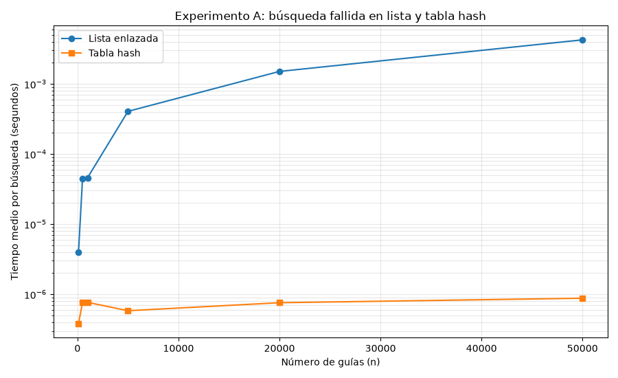
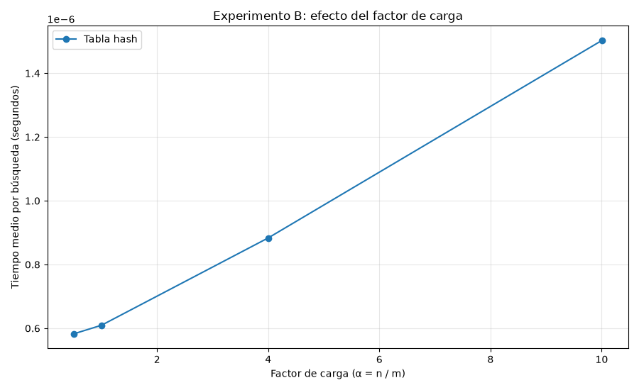

# Curso análisis de algoritmos 
## Estudiante: Carolina Uribe Builes


## Propósito carpetas y archivos  

* medicion.py:
* pruebas.py: Lógica para probar el funcionamiento de los métodos definidos en estructuras.py por medio de diferentes casos.
* estructuras.py: 
* graficas/: Carpeta que almacena las gráficas generadas en el laboratorio.

## Instrucciones para reproducir el laboratorio 
> Las siguientes instrucciones permiten configurar el entorno y ejecutar el laboratorio en Windows, macOS y Linux.

### Windows

Para reproducir el entorno y ejecutar los experimentos en Windows, siga los siguientes pasos:

1. Abra una terminal dentro de la carpeta nombrada `lab3-estructuras-datos`.

2. Cree el entorno virtual:

```bash
python -m venv venv
```

3. Active el entorno virtual:

```bash
venv\Scripts\activate
```

4. Instale las dependencias contenidas en el archivo `requirements.txt`:

```bash
python -m pip install -r requirements.txt
```

5. Ejecute el archivo `pruebas.py` para verificar el funcionamiento de los métodos:

```bash
python pruebas.py
```

6. Ejecute el archivo `medicion.py` para realizar las mediciones de tiempo y generar la gráfica:

```bash
python medicion.py
```

### macOS

Para reproducir el entorno y ejecutar los experimentos en macOS, siga los siguientes pasos:

1. Abra una terminal dentro de la carpeta nombrada `lab3-estructuras-datos`.

2. Cree el entorno virtual:

```bash
python3 -m venv venv
```

3. Active el entorno virtual:

```bash
source venv/bin/activate
```

4. Instale las dependencias contenidas en el archivo `requirements.txt`:

```bash
python3 -m pip install -r requirements.txt
```

5. Ejecute el archivo `pruebas.py` para verificar el funcionamiento de los métodos:

```bash
python3 pruebas.py
```

6. Ejecute el archivo `medicion.py` para realizar las mediciones de tiempo y generar la gráfica:

```bash
python3 medicion.py
```

### Linux

Para reproducir el entorno y ejecutar los experimentos en Linux, siga los siguientes pasos:

1. Abra una terminal dentro de la carpeta nombrada `lab3-estructuras-datos`.

2. Cree el entorno virtual:

```bash
python3 -m venv venv
```

3. Active el entorno virtual:

```bash
source venv/bin/activate
```

4. Instale las dependencias contenidas en el archivo `requirements.txt`:

```bash
python3 -m pip install -r requirements.txt
```

5. Ejecute el archivo `pruebas.py` para verificar el funcionamiento de los métodos:

```bash
python3 pruebas.py
```

6. Ejecute el archivo `medicion.py` para realizar las mediciones de tiempo y generar la gráfica:

```bash
python3 medicion.py
```

La gráfica generada se almacenará en la carpeta **`graficas/`**.

## Parte 1 - Implementar y verificar las dos estructuras
> Acceda al código de [estructuras.py](./estructuras.py) y [pruebas.py](./pruebas.py)

Para verificar el funcionamiento de las dos estructuras implementadas, se realizaron pruebas utilizando aserciones (assert) con el fin de garantizar que las operaciones de inserción y búsqueda devolvieran los resultados esperados. Se utilizaron casos de prueba específicos para validar el comportamiento de cada estructura, y sus resultados también se compararon en diferentes colecciones aleatorias para verificar que ambas estructuras permitieran consultar correctamente las guías almacenadas. 

Para este punto se trabajó con los siguientes casos de prueba:
- Lista enlazada: Se insertaron tres guías con diferentes estados y se verificó que la búsqueda devolviera el estado correspondiente a cada una. También se consultó una guía inexistente, cuyo resultado esperado es `None`, y se comprobó que el tamaño de la lista fuera de tres elementos. Esta prueba verificó el correcto funcionamiento de las operaciones básicas de inserción y búsqueda.
- Colisión forzada en la tabla hash: Se utilizó una tabla con siete casillas y se insertaron las guías `10`, `24` y `17`, que corresponden a la casilla 3 al aplicar el método de división. Se verificó que las tres guías podían almacenarse y recuperarse correctamente a pesar de compartir la misma casilla, lo que confirmó que la lista enlazada correspondiente tenía una longitud de tres elementos. Este caso permite verificar que el mecanismo de encadenamiento funciona para resolver colisiones.
- Búsqueda infructuosa en la tabla hash: Se consultó una guía que no se había insertado y se verificó que el resultado fuera `None`, lo que confirmó que la estructura identificaba correctamente las guías inexistentes.
- Factor de carga: Después de insertar las tres guías en la tabla de siete casillas, se verificó que el factor de carga era de `3/7`, basándose en la relación entre el número de elementos almacenados y el número de casillas disponibles.
- 20 colecciones aleatorias: Se generaron 20 colecciones, cada una con 50 claves únicas con valores asignados al azar. Para cada colección se verificó que la lista enlazada y la tabla hash devolvieran el mismo valor al consultar las claves existentes, y que ambas estructuras devolvieran `None` para 20 claves inexistentes. Finalmente, se verificó que ambas estructuras conservaran los 50 elementos insertados en cada colección.

Todas las pruebas se completaron con éxito, lo que permitió verificar el comportamiento de las operaciones implementadas, el manejo de las colisiones mediante el encadenamiento y la consistencia de los resultados obtenidos por ambas estructuras en diferentes casos de prueba.

## Parte 2 - Medir y graficar
> Acceda al código de [medicion.py](./medicion.py)

### (Experimento A) Gráfica: Lista vs Tabla 


### (Experimento B) Gráfica: Tiempo vs Alfa


Se realizaron dos experimentos para comparar el desempeño de la lista enlazada y la tabla hash. En el primer experimento, se utilizaron seis tamaños de entrada: `100`, `500`, `1000`, `5000`, `20000` y `50000`, con el objetivo de observar cómo varía el tiempo promedio de búsqueda a medida que aumenta el número de elementos. Para cada valor de n, se seleccionó un tamaño de tabla **m** correspondiente a un número primo cercano a la mitad de n, con el objetivo de mantener el factor de carga alrededor de 2. Ambas estructuras de datos se construyeron con las mismas guías y estados, y se utilizaron 200 guías inexistentes para medir las búsquedas fallidas.

En el segundo experimento, se fijó n en 20000 y se utilizaron cuatro tamaños de tabla hash para obtener factores de carga cercanos a `0.5`, `1`, `4` y `10`, con el objetivo de observar cómo la ocupación de la tabla hash afecta el tiempo de búsqueda. En ambos experimentos, se utilizaron semillas fijas para generar los datos, y se verificó que las estructuras devolvieran los mismos estados al consultar una muestra de guías existentes. Además, se verificó que las búsquedas de guías inexistentes devolvieran `None` cuando correspondía.

El tiempo se midió utilizando `time.perf_counter()`, registrando únicamente el tiempo dedicado a las búsquedas. Para cada configuración, se realizaron 200 búsquedas infructuosas, y el tiempo total medido se dividió entre el número de búsquedas para obtener el tiempo promedio por consulta. Cada configuración se midió solo una vez, y no se calcularon promedios entre diferentes ejecuciones del experimento.

Resultados obtenidos tras la ejecución del código de medición:
| Experimento | $n$ | $m$ | $\alpha$ | Lista (s/búsqueda) | Tabla (s/búsqueda) |
| :---: | :---: | :---: | :---: | :---: | :---: |
| A | 100 | 47 | 2.128 | 0.00000395 | 0.00000038 |
| A | 500 | 251 | 1.992 | 0.00004492 | 0.00000076 |
| A | 1000 | 499 | 2.004 | 0.00004599 | 0.00000077 |
| A | 5000 | 2503 | 1.998 | 0.00040624 | 0.00000058 |
| A | 20000 | 10007 | 1.999 | 0.00150680 | 0.00000076 |
| A | 50000 | 24989 | 2.001 | 0.00425099 | 0.00000088 |
| B | 20000 | 40009 | 0.500 | - | 0.00000058 |
| B | 20000 | 19997 | 1.000 | - | 0.00000061 |
| B | 20000 | 4999 | 4.001 | - | 0.00000088 |
| B | 20000 | 1999 | 10.005 | - | 0.00000150 |

## Parte 3 - Respuestas análisis
1. Costo teórico:

2. Lo medido contra lo esperado:

3. Explicación colisiones:

4. Tabla hash o árbol de búsqueda:

5. Concepto para la jefa de operaciones:
